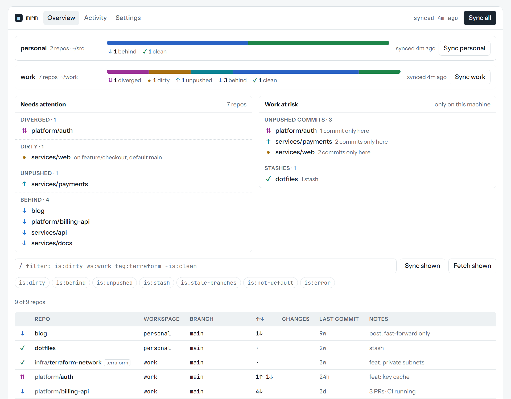
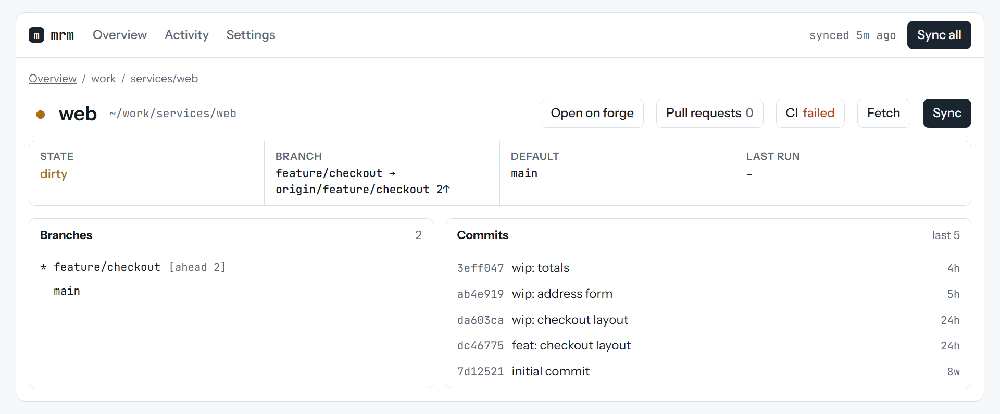
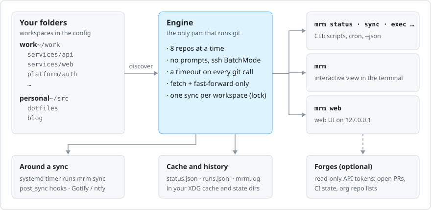

# mrm

**Mass repo manager** - see every git repo on your machine at once, and bring them all up to date safely, in parallel, from the terminal or the browser.

<p align="center"></p>

If you keep dozens of clones across work and personal folders, keeping them current means a loop of `cd`, `git status`, `git pull` - and the occasional surprise when a pull lands on top of uncommitted work. mrm replaces the loop:

- **Finds your repos.** Point it at folders; every repo under them is discovered. There is no list to keep up to date.
- **Shows their state.** One line per repo: behind, dirty, unpushed, diverged, stashed, on the wrong branch - plus what needs attention and which work exists only on this machine.
- **Updates them safely.** Fetch, then fast-forward, eight repos at a time. Anything where that isn't safe is skipped and explained. mrm never stashes, resets, rebases, merges or forces, so work in progress is never touched.
- **Three ways in, one engine.** A CLI for scripts and timers, an interactive terminal view, and a local web UI. All three give the same results.
- **Extras for a fleet of repos.** Run a command in every repo, prune merged branches, see open pull requests and CI, find org repos you haven't cloned, sync on a schedule with a notification.

Linux and macOS (amd64, arm64), and Windows through WSL.

- [mrm](#mrm)
  - [Install](#install)
  - [Get Started in Five Minutes](#get-started-in-five-minutes)
  - [Reading the Status](#reading-the-status)
  - [What Sync Does](#what-sync-does)
  - [The Interactive View](#the-interactive-view)
  - [The Web UI](#the-web-ui)
  - [Commands](#commands)
  - [How It Works](#how-it-works)
  - [Learn More](#learn-more)
  - [License](#license)

## Install
You need **git 2.35 or newer**. Then pick one:

```bash
# with Go 1.27 or newer
go install github.com/adegoodyer/mrm@latest

# or a release archive (Linux/macOS, amd64/arm64): unpack it and put mrm on your PATH
# https://github.com/adegoodyer/mrm/releases

# or from a checkout (needs Task: https://taskfile.dev)
git clone https://github.com/adegoodyer/mrm && cd mrm && task install
```

Check it worked:

```bash
mrm version
```

## Get Started in Five Minutes
**1. Write a config.** mrm looks for repos under the folders you give it. `config init` writes a commented config with one *workspace* for each common clone folder it finds (`~/src`, `~/code`, `~/projects`, `~/repos`, `~/work`, `~/dev`, `~/git`):

```bash
mrm config init     # writes ~/.config/mrm/config.yaml
mrm config edit     # opens it in $EDITOR, and checks it when you save
```

A workspace is a name for one or more folders. Two is typical:

```yaml
workspaces:
  work:
    roots: [~/work]
  personal:
    roots: [~/src]
```

No config at all? mrm then works on the folder you run it in.

**2. Check your setup.** `doctor` checks git, the config, the folders, ssh and every repo it finds, and says how to fix anything wrong:

```bash
mrm doctor
```

**3. Look at everything.** Nothing is changed or fetched:

```bash
mrm status              # every repo
mrm status -w work      # one workspace
mrm status -f is:dirty  # only repos with uncommitted changes
```

**4. See what a sync would do**, then do it:

```bash
mrm sync --dry-run
mrm sync
```

<p align="center"></p>

Anything skipped is listed under **Needs attention** with the reason, and the exit code is `2`. Fix those by hand (or in [lazygit](https://github.com/jesseduffield/lazygit)) and run `mrm sync` again.

**5. Try the other two ways in:**

```bash
mrm                 # the interactive view (press ? for keys, q to quit)
mrm web --open      # the web UI in your browser
```

That's the daily loop: `mrm`, look, `s` to sync, deal with what needs attention.

## Reading the Status
Each line is one repo: its state, name, current branch, commits ahead (`↑`) and behind (`↓`) its upstream, uncommitted changes, the age of the last commit, and notes.

| Glyph | State    | Meaning                                                                      |
| ----- | -------- | ---------------------------------------------------------------------------- |
| `✗`   | error    | the repo can't be read, or the last fetch failed                             |
| `≠`   | conflict | a merge, rebase, cherry-pick or revert is in progress                        |
| `⇅`   | diverged | ahead of and behind its upstream: needs a rebase or merge                    |
| `●`   | dirty    | staged, modified or conflicted files                                         |
| `↑`   | unpushed | commits that exist only here: ahead of upstream, or on a branch never pushed |
| `↓`   | behind   | behind its upstream, or the local default branch is behind its remote        |
| `✓`   | clean    | nothing to do                                                                |

Changes are counted as `S` staged, `M` modified, `U` conflicted and `?` untracked. Notes add what the glyph can't say: `stash`, `on feature/x, default main 3↓`, `2 unpushed`, `upstream-gone`, `stale-branches`, open PRs and a failing CI. The [user guide](docs/user-guide.md#states-and-flags) lists every one.

## What Sync Does
<p align="center"></p>

In short: if a fast-forward is safe, mrm does it; otherwise it leaves the repo exactly as it was and tells you why. When you're on a feature branch, your branch stays put, and the default branch is still brought up to date in place, so it's current when you switch back.

## The Interactive View
`mrm` on a terminal opens a live, grouped list of every repo. It appears at once from the last known state, then refreshes in the background.

<p align="center"></p>

Mark repos with `space` (or a whole group on its header), then `s` to sync or `f` to fetch them; with nothing marked, the action applies to the group or repo under the cursor. `/` filters as you type, `!` shows only what needs attention, `enter` hands off to lazygit in that repo, and `ctrl+k` opens a command palette with everything else. `l` opens a detail pane:

<p align="center"></p>

All the keys are in the [user guide](docs/user-guide.md#the-interactive-view), or press `?`.

## The Web UI
`mrm web --open` serves an overview of every repo on this machine only (127.0.0.1, with a new access token each run) and opens it in your browser. Ctrl+C stops it.

<picture>
  <source media="(prefers-color-scheme: dark)" srcset="docs/images/web-overview-dark.png">
  
</picture>

You get a state bar per workspace, what needs attention, the **work at risk** that exists only on this machine (unpushed commits, stashes, long-dirty trees), and every repo in a table you can filter. Sync or fetch one repo, a workspace, the filtered set or everything; rows update live in every open tab. A sync started from a terminal shows in the top bar while it runs, and its results appear when it finishes. Each repo has its own page:

<picture>
  <source media="(prefers-color-scheme: dark)" srcset="docs/images/web-repo-dark.png">
  
</picture>

Light and dark themes and four text sizes are on the Settings page.

## Commands
Every command takes `-w <workspace>`, `-t <tag>` and `-f "<filter>"` to choose repos, `--json` for scripts and `--no-color`. `mrm <command> --help` has examples.

| Command                              | Does                                                                                  |
| ------------------------------------ | ------------------------------------------------------------------------------------- |
| `mrm`                                | the interactive view (on a terminal; piped, it prints `mrm status`)                   |
| `mrm status`                         | one line per repo; `--fetch` fetches first                                            |
| `mrm sync`                           | fetch and fast-forward what is safe to; `--dry-run` says what it would do             |
| `mrm fetch`                          | fetch only                                                                            |
| `mrm web`                            | the web UI; `--open`, `--port`                                                        |
| `mrm open [repo]`                    | the repo on GitHub, GitLab, Bitbucket or Gitea; `--pr`, `--ci`, `--branch`, `--print` |
| `mrm exec -- <command>`              | run a command in every repo, in parallel; `--serial` for interactive ones             |
| `mrm prune`                          | delete local branches that are already merged, after asking                           |
| `mrm drift`                          | config entries with no repo, and repos in your forge orgs you haven't cloned          |
| `mrm schedule install\|list\|remove` | sync on a timer (systemd)                                                             |
| `mrm config init\|edit\|path`        | write, edit or locate the config                                                      |
| `mrm doctor`                         | check git, the config, folders, repos, ssh and tokens                                 |
| `mrm completion bash\|zsh\|fish`     | shell completion ([setup](docs/user-guide.md#shell-completion))                       |

Filters work the same everywhere - on the command line, in the interactive view and in the web UI:

```bash
mrm status -f "is:behind ws:work"
mrm sync -f "tag:terraform -is:dirty"
mrm status -f "age:>90d"              # last commit over 90 days ago
mrm status -f "branch:feature/* forge:gitlab"
```

## How It Works
<p align="center"></p>

mrm runs the `git` you already have, with your ssh keys and credentials, so anything you can `git fetch` by hand it can too. Prompts are switched off and every git command has a timeout, so a repo that wants a password fails with a plain reason instead of hanging the run. It keeps its files in the standard places:

| What                    | Where                                                          |
| ----------------------- | -------------------------------------------------------------- |
| config                  | `~/.config/mrm/config.yaml` (`$XDG_CONFIG_HOME`)               |
| status and forge caches | `~/.cache/mrm/` (`$XDG_CACHE_HOME`)                            |
| run history and log     | `~/.local/state/mrm/runs.jsonl`, `mrm.log` (`$XDG_STATE_HOME`) |

`mrm config path` prints them for your machine.

## Learn More
The [user guide](docs/user-guide.md) covers everything in depth:

- [Concepts](docs/user-guide.md#concepts) - workspaces, discovery, groups, tags, the default branch, states and flags
- [Configuration](docs/user-guide.md#configuration) - every key, per-repo exceptions, secrets
- [Syncing](docs/user-guide.md#syncing) - the rules, sync policies, locks, exit codes
- [Filters](docs/user-guide.md#filters) - the full query language
- [Working across repos](docs/user-guide.md#working-across-repos) - `exec`, `prune`, `drift`
- [Pull requests and CI](docs/user-guide.md#pull-requests-and-ci) - forge tokens
- [Scheduled sync and notifications](docs/user-guide.md#scheduled-sync)
- [Scripting](docs/user-guide.md#scripting) - JSON output and exit codes
- [Troubleshooting](docs/user-guide.md#troubleshooting) - common problems and their fixes

For how mrm is designed and built: the [specification](docs/01-specification.md), the [user acceptance tests](docs/02-user-acceptance-tests.md), the [roadmap](docs/03-roadmap.md), the [developer notes](README-dev.md) and the [changelog](CHANGELOG.md).

## License
[MIT](LICENSE)
