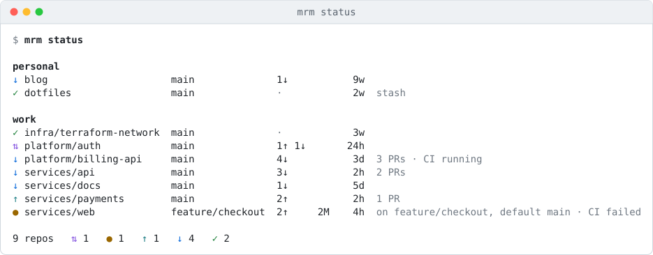
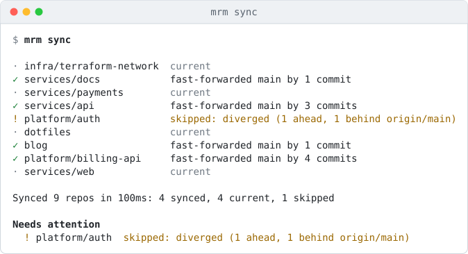
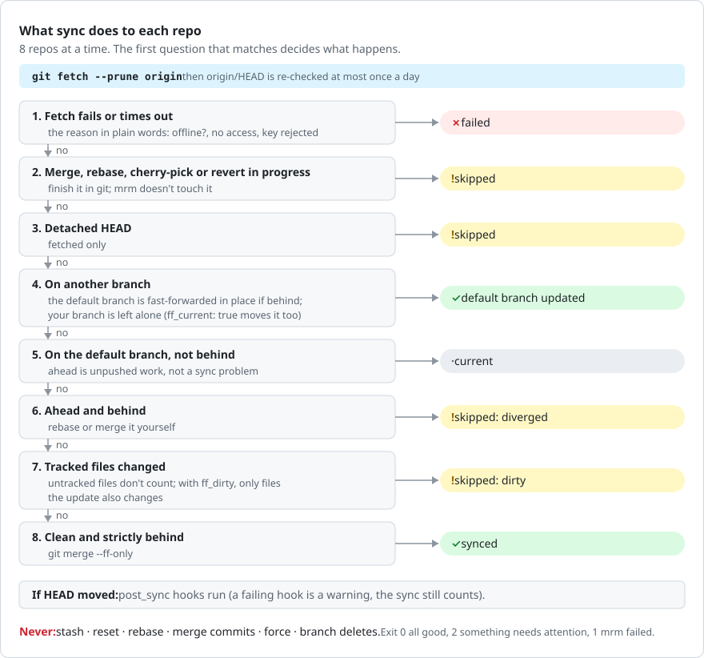
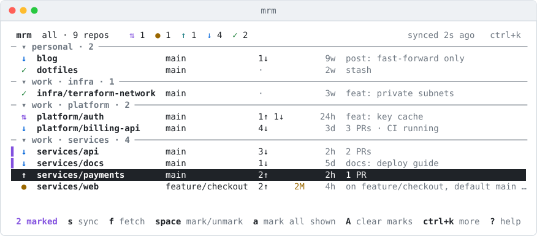
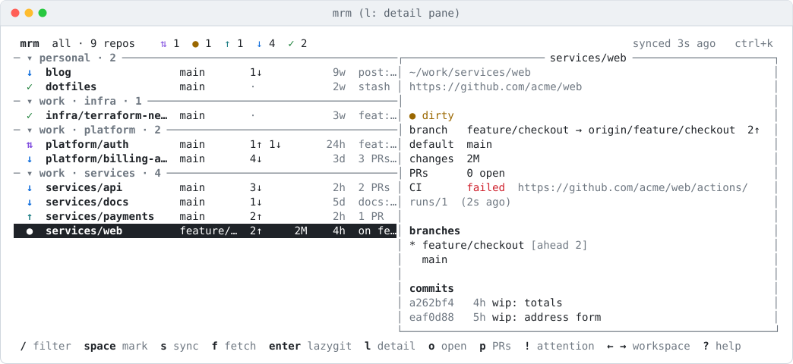

# mrm User Guide

Everything about using mrm, from the ideas it is built on to every setting. New to mrm? Start with the [README](../README.md): it installs mrm and walks through a first sync in five minutes.

- [mrm User Guide](#mrm-user-guide)
  - [Concepts](#concepts)
    - [Workspaces and Roots](#workspaces-and-roots)
    - [Discovery](#discovery)
    - [Groups and Tags](#groups-and-tags)
    - [VCS Hosts](#vcs-hosts)
    - [The Default Branch](#the-default-branch)
    - [States and Flags](#states-and-flags)
    - [Outcomes](#outcomes)
  - [Configuration](#configuration)
    - [A Full Example](#a-full-example)
    - [Settings Reference](#settings-reference)
    - [Per-Repo Exceptions](#per-repo-exceptions)
    - [Secrets](#secrets)
  - [Status](#status)
  - [Syncing](#syncing)
    - [Sync, Step by Step](#sync-step-by-step)
    - [Compared With git pull](#compared-with-git-pull)
    - [Sync Policies](#sync-policies)
    - [One Sync at a Time](#one-sync-at-a-time)
  - [Filters](#filters)
  - [The Interactive View](#the-interactive-view)
  - [The Web UI](#the-web-ui)
  - [Opening Repos in the Browser](#opening-repos-in-the-browser)
  - [Working Across Repos](#working-across-repos)
    - [exec](#exec)
    - [prune](#prune)
    - [drift](#drift)
  - [Pull Requests and CI](#pull-requests-and-ci)
  - [Hooks](#hooks)
  - [Scheduled Sync](#scheduled-sync)
  - [Notifications](#notifications)
  - [Scripting](#scripting)
  - [Shell Completion](#shell-completion)
  - [Troubleshooting](#troubleshooting)
  - [Uninstall](#uninstall)

## Concepts
Five words do most of the work in mrm. Each has one job:

| Term          | What it is                                                         | Example                         | Used for                                                         |
| ------------- | ------------------------------------------------------------------ | ------------------------------- | ---------------------------------------------------------------- |
| **Workspace** | a named set of root folders, with its own sync settings            | `work`, `personal`              | `-w`, `←` `→` in the interactive view, schedules, `drift` orgs   |
| **Group**     | a section of the list inside a workspace; one per repo             | `platform`, `infra`             | the headings in the interactive view, `group:`                   |
| **Tag**       | a label; a repo can have any number                                | `terraform`, `team-pay`         | picking repos with `-t` and `tag:`                               |
| **VCS host**  | the site a repo's remote points at                                 | GitHub, GitLab, Bitbucket       | opening pages, PR and CI counts, `host:`                         |
| **Root**      | a folder mrm looks for clones in                                   | `~/work`                        | where discovery starts                                           |

### Workspaces and Roots
A **workspace** is a named set of folders - its **roots** - that hold clones. Most people have two, `work` and `personal`, but any number works. Each workspace can have its own [sync policy](#sync-policies), and `-w <name>` limits any command to it:

```yaml
workspaces:
  work:
    roots: [~/work, ~/clients]
  personal:
    roots: [~/src]
```

With no config file, mrm treats the folder you run it in as the only root.

### Discovery
mrm walks each root looking for git repos; you never list them. The walk:

- goes `depth` folders down (default 3), so `~/work/platform/billing-api` is found from `~/work`;
- stops at a repo: submodules and nested worktrees aren't listed as repos of their own;
- skips hidden folders (`.cache`, `.terraform`) and anything matching the workspace's `ignore` globs (`legacy-*`, `vendor/*`).

A new clone shows up the next time mrm runs. A repo that disappears is simply gone from the list; [`mrm drift`](#drift) reports config entries that point at it.

### Groups and Tags
The folders between a root and a repo become its **group**: `~/work/platform/billing-api` is `billing-api` in group `platform`, shown as `platform/billing-api`. The interactive view and the web UI list repos by workspace and group, and `group:platform` filters to them.

When your folders are flat but the names follow a pattern, the config can group them instead - the folder is left as it is:

```yaml
repos:
  "inf-*":
    group: infra
  "docker-*":
    group: docker
```

A repo is in one group. Repos in no group are listed last, under *(no group)*; a workspace with no groups at all is one section named after the workspace.

**Tags** are labels you give repos in the config, by name or by path glob. Unlike groups, a repo can have many. Use them for sets that cut across groups - all Terraform repos, everything a team owns:

```yaml
repos:
  "~/work/terraform-*":
    tags: [terraform]
  payments-service:
    tags: [backend, team-pay]
```

Then `-t terraform`, or `tag:terraform` in a filter.

### VCS Hosts
A repo's **VCS host** is the site its remote points at: GitHub, GitLab, Bitbucket, Gitea or Codeberg (Codeberg runs Gitea). mrm works out which from the remote URL, `git@github.com:acme/api.git` → GitHub, and uses that to open pages in your browser, to ask for pull requests and CI with an [API token](#pull-requests-and-ci), and for [`mrm drift`](#drift). Self-hosted ones whose name doesn't say what they are go under `hosts:` in the config:

```yaml
hosts:
  git.example.com: gitlab       # github | gitlab | bitbucket | gitea
```

Before 0.3.0 the config called these *forges*: `forges:`, `forge_tokens:`, `forge_cache:` and the `forge:` filter. The old names still work, and `mrm doctor` says to rename them.

### The Default Branch
Sync brings each repo's **default branch** up to date - the branch your VCS host calls default (`main`, `master`, `develop`). mrm reads it from `origin/HEAD`, which git sets when you clone. GitHub, GitLab and the rest let you change the default later, and a clone doesn't notice, so mrm re-checks `origin/HEAD` on a fetch when it was last checked over a day ago. With no `origin/HEAD` at all, mrm guesses `main`, then `master`, and `mrm doctor` lists the repo with the command that fixes it. To pin a branch for one repo, set `branch:` in its [exception](#per-repo-exceptions).

### States and Flags
Each repo has one **state** - the first of these that applies - shown as a glyph and a colour:

| Glyph | State      | Meaning                                                                                         |
| ----- | ---------- | ----------------------------------------------------------------------------------------------- |
| `✗`   | `error`    | the repo can't be read, or its last fetch failed (until a fetch works again)                    |
| `≠`   | `conflict` | a merge, rebase, cherry-pick or revert is in progress                                           |
| `⇅`   | `diverged` | ahead of and behind its upstream at once: needs a rebase or merge                               |
| `●`   | `dirty`    | staged, modified or conflicted files                                                            |
| `↑`   | `unpushed` | commits that exist only here: ahead of the upstream, or on a local branch that was never pushed |
| `↓`   | `behind`   | behind its upstream, or the local default branch is behind the remote's                         |
| `✓`   | `clean`    | nothing to do                                                                                   |

**Flags** add detail any state can have. They show as notes and work in filters as `is:<flag>`:

| Flag             | Meaning                                                                                                               |
| ---------------- | --------------------------------------------------------------------------------------------------------------------- |
| `stash`          | there are stashes                                                                                                     |
| `untracked`      | untracked files (they don't make a repo dirty, and sync ignores them)                                                 |
| `not-default`    | on a branch other than the default; the note says which, and how far the default branch is behind                     |
| `detached`       | `HEAD` is detached                                                                                                    |
| `no-upstream`    | the current branch tracks nothing                                                                                     |
| `upstream-gone`  | the current branch's upstream was deleted on the remote                                                               |
| `stale-branches` | local branches whose upstream is gone - usually merged and deleted on the VCS host; [`mrm prune`](#prune) tidies them |
| `no-remote`      | the repo has no remote; it is listed but never fetched                                                                |

`is:ahead` matches any repo with commits to push. A branch whose upstream is gone is counted as stale, not as unpushed work: its commits were pushed once.

### Outcomes
After a sync or fetch each repo has an **outcome**, shown in the live lines, the summary and the run history:

| Outcome    | Meaning                                                                                                             |
| ---------- | ------------------------------------------------------------------------------------------------------------------- |
| `synced`   | something moved: `fast-forwarded main by 3 commits`                                                                 |
| `current`  | already up to date                                                                                                  |
| `fetched`  | fetched only (`mrm fetch`)                                                                                          |
| `would`    | a dry run (`--dry-run`): what a real sync would do, e.g. `would fast-forward main by 3 commits`. Nothing is changed |
| `excluded` | left alone on purpose: `sync: false` in the config, or no remote                                                    |
| `skipped`  | left alone because changing it wasn't safe; the reason says why                                                     |
| `failed`   | git failed - offline, no access, a timeout; the reason is in plain words                                            |

`skipped` and `failed` **need attention**: they are listed after the run, the exit code is `2`, and the interactive view and web UI group them in a needs-attention list.

## Configuration
The config is `~/.config/mrm/config.yaml` (`$XDG_CONFIG_HOME/mrm/config.yaml`). Another file can be used with `-c <path>` or `MRM_CONFIG=<path>`.

```bash
mrm config init      # write a commented one (refuses to overwrite; --force to replace)
mrm config edit      # open in $VISUAL or $EDITOR, then check it
mrm config path      # print the config, cache, history, log and lock paths
```

The config is strict: an unknown key, a bad glob or a duration like `2 minutes` is an error with the line it is on, so a typo can't be silently ignored. mrm never writes to it.

### A Full Example
Every key, with its default where it has one. Only `workspaces` is needed.

```yaml
concurrency: 8                    # repos worked on at once
timeout: 30s                      # per git command, per repo
browser_cmd: ""                   # how to open URLs; default wslview on WSL, else xdg-open / open

hosts:                            # self-hosted VCS hosts, by hostname, so URLs and filters work
  git.example.com: gitlab         # github | gitlab | bitbucket | gitea

workspaces:
  work:
    roots: [~/work]
    depth: 3                      # how many folders down to look
    ignore: [legacy-*, "*-archive"]
    orgs: [github.com/<org>]      # for mrm drift
    sync:
      remote: origin
      ff_current: false           # also fast-forward a non-default current branch
      switch_merged: false        # leave a merged branch for the default one
      ff_dirty: false             # fast-forward over local changes the update doesn't touch
  personal:
    roots: [~/src]

repos:                            # exceptions only; see below
  payments-service:
    branch: develop               # instead of origin/HEAD
    tags: [backend]
  "~/work/terraform-*":
    tags: [terraform]
    group: infra                  # instead of the folder's group
  legacy-portal:
    sync: false                   # status only, never synced

hooks:
  post_sync:
    - name: pre-commit
      if_file: .pre-commit-config.yaml
      run: pre-commit install --install-hooks

notify:
  on: attention                   # attention | always | never
  gotify:
    url: <gotify-url>
    token_cmd: pass show gotify/mrm
  ntfy:
    url: <ntfy-url>/<topic>
    token_env: MRM_NTFY_TOKEN

host_tokens:
  github.com:
    token_cmd: gh auth token
host_cache: 10m

tui:
  open_cmd: lazygit               # what enter hands off to
  fetch_on_start: false
  mouse: true                     # click and scroll in the list

web:
  port: 7420
  text_size: medium               # small | medium | large | extra-large
```

### Settings Reference

| Key                                    | Default     | Meaning                                                                                                        |
| -------------------------------------- | ----------- | -------------------------------------------------------------------------------------------------------------- |
| `concurrency`                          | `8`         | repos worked on at once                                                                                        |
| `timeout`                              | `30s`       | limit for each git command; a fetch that takes longer fails with `timed out`                                   |
| `browser_cmd`                          | -           | command to open URLs; default `wslview` on WSL, else `xdg-open` or `open`                                      |
| `hosts.<hostname>`                     | -           | the kind of a self-hosted VCS host: `github`, `gitlab`, `bitbucket` or `gitea`                                 |
| `workspaces.<name>.roots`              | (required)  | folders to look in; `~` is expanded                                                                            |
| `workspaces.<name>.depth`              | `3`         | how many folders below a root to look                                                                          |
| `workspaces.<name>.ignore`             | -           | name or relative-path globs to skip                                                                            |
| `workspaces.<name>.orgs`               | -           | `host/owner` on GitHub, GitLab, Bitbucket or Gitea, for [`mrm drift`](#drift)                                  |
| `workspaces.<name>.sync.remote`        | `origin`    | the remote to fetch and fast-forward from                                                                      |
| `workspaces.<name>.sync.ff_current`    | `false`     | also fast-forward a non-default current branch ([policies](#sync-policies))                                    |
| `workspaces.<name>.sync.switch_merged` | `false`     | switch away from a pushed branch that is merged ([policies](#sync-policies))                                   |
| `workspaces.<name>.sync.ff_dirty`      | `false`     | fast-forward a dirty repo when the update touches none of its changed files ([policies](#sync-policies))       |
| `repos.<key>.branch`                   | -           | the default branch for that repo, instead of `origin/HEAD`                                                     |
| `repos.<key>.tags`                     | -           | labels for `-t` and `tag:`                                                                                     |
| `repos.<key>.group`                    | (folder)    | the repo's group, instead of the folders between the root and the repo                                         |
| `repos.<key>.sync`                     | `true`      | `false`: show the repo, never sync it                                                                          |
| `hooks.post_sync[]`                    | -           | `name`, `if_file`, `run` ([Hooks](#hooks))                                                                     |
| `notify.on`                            | `attention` | when to notify after a headless sync: `attention`, `always`, `never`                                           |
| `notify.gotify` · `notify.ntfy`        | -           | `url`, and `token_cmd` or `token_env` ([Notifications](#notifications))                                        |
| `host_tokens.<hostname>`               | -           | `token_cmd` or `token_env`, and `user` for Bitbucket ([Pull requests and CI](#pull-requests-and-ci))           |
| `host_cache`                           | `10m`       | how long PR and CI answers are reused                                                                          |
| `tui.open_cmd`                         | `lazygit`   | what `enter` runs in the repo                                                                                  |
| `tui.fetch_on_start`                   | `false`     | fetch everything when the interactive view opens                                                               |
| `tui.mouse`                            | `true`      | click a row to select it, scroll with the wheel; `false` leaves the mouse to the terminal (for selecting text) |
| `web.port`                             | `7420`      | the web UI's port                                                                                              |
| `web.text_size`                        | `medium`    | the web UI's default text size; each browser can change it                                                     |

Environment: `MRM_CONFIG` picks the config file, `NO_COLOR` (or `--no-color`) turns colour off, and the XDG variables move mrm's files.

### Per-Repo Exceptions
Keys under `repos:` say which repos an exception applies to:

| Key                    | Matches                                   |
| ---------------------- | ----------------------------------------- |
| `payments-service`     | a repo with that name                     |
| `legacy-*`             | repos whose name matches the glob         |
| `"~/work/terraform-*"` | repos whose path matches (a `/` or a `~`) |

When several keys match one repo, path globs apply first, then name globs, then the exact name, so the most specific one wins (for `branch`, `sync` and `group`); between two of the same kind, the key that sorts last wins. Tags from all of them are combined. Quote keys that start with `~` or contain `*`.

### Secrets
Tokens never go in the config. Every secret is read from a command (`token_cmd`) or an environment variable (`token_env`):

```yaml
token_cmd: pass show gotify/mrm         # or: gh auth token, op read op://..., secret-tool lookup ...
token_env: MRM_NTFY_TOKEN
```

A literal `token:` is refused with a hint. Secrets are sent in request headers, never written to logs, and hidden on the web UI's Settings page. Because hooks and `token_cmd` run commands, the config is trusted input: `mrm doctor` warns if other users can write to it.

## Status
`mrm status` reads every repo's state from git - nothing is fetched or changed - and prints one line each, under a heading per workspace:



Columns: state glyph, name (`group/name`), current branch, ahead `↑` and behind `↓` its upstream, changes (`S` staged, `M` modified, `U` conflicted, `?` untracked), age of the last commit, then notes. The last line counts repos by state.

- `--fetch` fetches every repo first, so behind counts are current. Without it they are as of the last fetch - by mrm or by you.
- `-f`, `-w`, `-t` choose repos ([Filters](#filters)).
- With [API tokens](#pull-requests-and-ci), notes include open pull requests and a failing or running CI. `--no-prs` skips asking for them.
- `--json` prints everything for scripts ([Scripting](#scripting)).

Reading status took about half a second for 86 repos on a laptop. The result is cached, so the interactive view and the web UI open at once.

## Syncing
`mrm sync` fetches every repo and fast-forwards what is safe to, 8 at a time (the ones that were slowest last time first, so a slow VCS host doesn't hold up the end), with a live line for each repo as it finishes and a summary at the end:



For each repo, the first rule that matches decides what happens:



- **Fast-forward only.** A branch only moves if it is strictly behind; anything else is left exactly as it was. mrm never stashes, resets, rebases, makes a merge commit, forces anything or deletes a branch during a sync.
- **Your branch stays put.** On a feature branch, the default branch is updated in place (`git fetch . origin/main:main`, no checkout), so it's current when you switch back. Your branch moves only with `ff_current`.
- **Untracked files don't count as dirty.** A fast-forward that would overwrite one is refused by git, and mrm reports git's message.
- `mrm sync --dry-run` (`-n`) fetches and says what would happen, changing no branch.
- `mrm fetch` is the first step alone: fetch, never fast-forward.
- **A failed fetch is remembered.** The repo stays `error` (`✗`, `is:error`), noting `last fetch failed: …`, until a fetch works again - through restarts and status reads, not only in the run that failed.

Every run is appended to the history (`~/.local/state/mrm/runs.jsonl`), which the web UI's Activity page shows. Exit codes: `0` every repo synced or current, `2` some need attention, `1` mrm itself failed (a bad config, say).

### Sync, Step by Step
These are the exact git commands, per repo. Each runs with prompts switched off (`GIT_TERMINAL_PROMPT=0`, ssh in batch mode) and the `timeout`, so nothing can wait for a password.

| #   | When                                                                   | Command                                                                                                        |
| --- | ---------------------------------------------------------------------- | -------------------------------------------------------------------------------------------------------------- |
| 1   | always                                                                 | `git fetch --prune --quiet origin`                                                                             |
| 2   | `origin/HEAD` last checked over a day ago                              | `git remote set-head origin --auto`                                                                            |
| 3   | always                                                                 | `git status --porcelain=v2 --branch --show-stash`, which every decision below is made from                     |
| 4   | `switch_merged`, on a pushed, clean branch merged into the default one | `git merge-base --is-ancestor HEAD origin/main`, then `git switch main`                                        |
| 5   | on the default branch, clean and strictly behind                       | `git merge --ff-only @{u}`                                                                                     |
| 5a  | same, but dirty, with `ff_dirty`                                       | `git diff --name-only HEAD` and `git diff --name-only HEAD @{u}`; if they share no file, step 5                |
| 6   | on another branch, the default branch strictly behind                  | `git fetch . origin/main:main` - moves `main` without checking it out; git refuses anything but a fast-forward |
| 7   | `ff_current`, the current branch clean and strictly behind             | `git merge --ff-only @{u}`                                                                                     |
| 8   | `HEAD` moved                                                           | your `post_sync` hooks                                                                                         |

`--dry-run` runs steps 1-3 and the checks, and reports what steps 4-7 would do.

### Compared With git pull
`git pull` is `git fetch` followed by `git merge` (or `git rebase` with `pull.rebase`). With uncommitted changes it does one of these:

| Your changes and the incoming commits     | `git pull`                                                                                                    | `mrm sync`                                                          |
| ----------------------------------------- | ------------------------------------------------------------------------------------------------------------- | ------------------------------------------------------------------- |
| touch the same files                      | refuses: "Your local changes to the following files would be overwritten by merge". Nothing changes           | skipped: dirty. Nothing changes                                     |
| touch different files                     | updates the branch and keeps your edits                                                                       | skipped: dirty; with `ff_dirty`, fast-forwards and keeps your edits |
| your branch has commits of its own too    | makes a merge commit, or (recent git) refuses until you choose with `pull.rebase` / `pull.ff`                 | skipped: diverged. Never merges or rebases                          |
| `pull.rebase=true` and any tracked change | refuses ("cannot pull with rebase: You have unstaged changes") unless `rebase.autoStash` stashes them for you | as above - mrm never stashes                                        |

So mrm never does anything `git pull` wouldn't, and stops in every case where `git pull` would merge, rebase or stash.

### Sync Policies
Three opt-in behaviours, set per workspace under `sync:`:

| Setting               | What it does                                                                                                                                                                                                                                                                                                                                      |
| --------------------- | ------------------------------------------------------------------------------------------------------------------------------------------------------------------------------------------------------------------------------------------------------------------------------------------------------------------------------------------------- |
| `ff_current: true`    | on a non-default branch, also fast-forward that branch when it is clean and strictly behind its upstream                                                                                                                                                                                                                                          |
| `switch_merged: true` | when the current branch was pushed, is clean, and is fully merged into the remote default branch, switch to the default branch first (then sync it). Branches never pushed are left alone                                                                                                                                                         |
| `ff_dirty: true`      | fast-forward a repo with uncommitted changes when the update changes none of the same files - your edits stay as they are. If it would touch one, the repo is skipped and the reason names the files (`dirty: the update changes README.md too`). This is what `git pull` would do, minus the merge; see [Sync, step by step](#sync-step-by-step) |

`remote:` changes the remote from `origin`, for workspaces that use `upstream` or another name.

### One Sync at a Time
A sync takes a lock per workspace, so a timer firing while you sync by hand can't run two syncs over the same repos; the second one says `sync already running for workspace work (pid 4242)`. `status`, the interactive view and the web UI keep working during a sync, and the web UI shows a sync running in another process in its top bar.

## Filters
One query language everywhere: `-f "<query>"` on the command line, `/` in the interactive view, the filter box in the web UI. Terms are combined with AND; `-` in front of a term negates it.

| Term                      | Matches                                                                                                                     |
| ------------------------- | --------------------------------------------------------------------------------------------------------------------------- |
| `api`                     | repos whose name or path contains `api` (plain substring, not fuzzy)                                                        |
| `is:<state>`              | `error`, `conflict`, `diverged`, `dirty`, `unpushed`, `behind`, `clean`                                                     |
| `is:<flag>`               | `stash`, `untracked`, `not-default`, `detached`, `no-upstream`, `upstream-gone`, `stale-branches`, `no-remote`, and `ahead` |
| `ws:<name>`               | workspace                                                                                                                   |
| `group:<name>`            | group folder                                                                                                                |
| `tag:<name>`              | tag from the config                                                                                                         |
| `branch:<glob>`           | current branch, e.g. `branch:feature/*`                                                                                     |
| `host:<kind or hostname>` | `github`, `gitlab`, `bitbucket`, `gitea` or a hostname like `git.example.com`; map self-hosted ones under `hosts:`          |
| `age:>30d` · `age:<12h`   | last commit older or newer than; `d` days, `w` weeks, or a duration like `12h`                                              |

```bash
mrm status -f "is:dirty ws:work"
mrm sync -f "tag:terraform -is:dirty"
mrm status -f "is:stash age:>60d"             # old stashes you may have forgotten
mrm status -f "is:not-default group:services"
```

`-w work` and `-t terraform` are shortcuts for `ws:work` and `tag:terraform`.

## The Interactive View
`mrm` on a terminal opens it (`mrm -w work -f is:dirty` starts on a workspace and filter). Piped, or with `--json`, `mrm` prints `mrm status` instead. It opens at once from the cache, then reads every repo again in the background; with `tui.fetch_on_start: true` it fetches too. It reopens where you left it - the same workspace, collapsed groups and detail pane, kept in `~/.local/state/mrm/tui.json` - unless `-w` picks a workspace.



- **Targets.** Sync (`s`), fetch (`f`), delete (`d`) and the browser keys (`o` `p` `P` `b`) act on the marked repos; with none marked, on the group under the cursor (on a header) or the repo under it. Opening more than 5 pages asks first. Marks clear once a sync or fetch starts. The other keys (`enter`, `e`, `t`, `l`, `L`) act on the repo under the cursor.
- **Deleting repos.** `d` moves the targets' folders to your trash (`~/.local/share/Trash` on Linux and WSL, `~/.Trash` on macOS), so you can restore them from a file manager or by moving them back. First mrm reads each repo again and shows one confirmation listing them, flagging any with work that exists only on this machine - unpushed commits, uncommitted changes, untracked files, stashes; `y` goes ahead, `n` or `esc` cancels. It never touches a workspace root or a folder that isn't a git repo, and waits while a sync runs. A repo on another drive than your home (a Windows drive on WSL) goes to that drive's trash through `gio`, when it is installed.
- **One operation at a time**, each repo's row showing a spinner until it is done. A sync takes the same lock and writes the same history as `mrm sync`. When a sync leaves anything skipped or failed, the view switches to the needs-attention list.
- **The mouse** selects a row with a click (a second click on a group header collapses or expands it) and scrolls with the wheel. While mrm has the mouse, most terminals still select text with `shift` held down; `tui.mouse: false` gives the mouse back entirely.
- **The footer** shows as many keys as fit, most useful first, and changes with what you're on: a repo, a group header, marked repos, a filter. `?` lists them all.
- **Quitting** while an operation runs needs `q` twice; git finishes what it started either way.

| Key                         | Action                                                                                                 |
| --------------------------- | ------------------------------------------------------------------------------------------------------ |
| `j` `k` `↑` `↓`             | move                                                                                                   |
| `J` `K` `shift+↓` `shift+↑` | move 10                                                                                                |
| `g` `Home` · `G` `End`      | top · bottom                                                                                           |
| `PgUp` `PgDn`               | page up, page down                                                                                     |
| `tab`                       | collapse or expand the group                                                                           |
| `shift+tab`                 | collapse every group, or expand them all when all are collapsed                                        |
| `←` `→`                     | previous or next workspace; *all* is one of them, and the cycle wraps                                  |
| `space`                     | mark the repo, or the whole group on its header                                                        |
| `a` · `A`                   | mark everything shown · clear marks                                                                    |
| `s` · `S`                   | sync the targets · sync everything shown                                                               |
| `f` · `F`                   | fetch the targets · fetch everything shown                                                             |
| `d`                         | move the targets' folders to the trash, after one confirmation ([below](#the-interactive-view))        |
| `r`                         | look for repos again and read their status: deleted ones drop off, new clones appear                   |
| `o` · `p` · `P` · `b`       | open in the browser: the repo · its pull requests · its pipelines or actions (CI) · the current branch |
| `enter`                     | hand off to `tui.open_cmd` (lazygit) in the repo; back to mrm when it exits                            |
| `e` · `t`                   | `$VISUAL`/`$EDITOR` · `$SHELL` in the repo                                                             |
| `/`                         | filter as you type; `enter` keeps it, `esc` clears it                                                  |
| `!`                         | needs attention: everything not clean, grouped by reason                                               |
| `l`                         | the detail pane                                                                                        |
| `L`                         | the commit graph: every branch, tag and remote, newest first; `esc` closes it                          |
| `ctrl+d` `ctrl+u`           | scroll the detail pane (or the graph) half a page; with the pane closed, move the list                 |
| `w`                         | pick a workspace from a list                                                                           |
| `ctrl+k`                    | command palette: fuzzy search over every action, workspace and common filter                           |
| `esc`                       | clear the filter, else leave the attention view, else clear marks                                      |
| `?` · `q`                   | help · quit                                                                                            |

The **detail pane** (`l`) shows the repo's path and web address, branch and upstream, the default branch, the last run's outcome, open PRs and CI (with [tokens](#pull-requests-and-ci)), every branch with its tracking, stashes, and the last 12 commits:



Colours come from your terminal's palette, so light and dark themes both work. Under `NO_COLOR` or `--no-color`, bold, dim and reverse still carry the meaning. It works from 80 x 24.

## The Web UI
`mrm web --open` prints an address like `http://127.0.0.1:7420/?token=<random>` and opens it; Ctrl+C stops the server. `-w` limits it to some workspaces and `--port` overrides `web.port`.

| Page         | Shows                                                                                                                                                                                           |
| ------------ | ----------------------------------------------------------------------------------------------------------------------------------------------------------------------------------------------- |
| **Overview** | a state bar per workspace; **needs attention**, grouped by reason; **work at risk** - unpushed commits, stashes, dirty trees older than a day, stale branches; every repo in a filterable table |
| **Repo**     | state, branch and upstream, default branch, last run, branches, stashes, the last 20 commits; buttons to open the repo, its PRs and its CI in the browser                                       |
| **Activity** | every sync and fetch from the history - from the CLI, the interactive view or the page - with each repo's outcome                                                                               |
| **Settings** | text size (Small, Medium, Large, Extra large) and theme (System, Light, Dark) for this browser; the config as loaded, with secrets hidden                                                       |

Sync or fetch one repo, a workspace, the filtered set or everything. Rows update live in every open tab as each repo finishes. A sync started elsewhere shows in the top bar while it runs, and the rows reload when it finishes. Long groups show 8 repos and a "+ N more" link to the filtered table.

**Security.** The server listens on 127.0.0.1 only. The token in the address is new each run and becomes a cookie after the first page; requests without it are refused, as are requests whose `Host` isn't `127.0.0.1` or `localhost` (DNS rebinding) and actions without the token header (cross-site requests). The page loads nothing from the internet - fonts are built in - and offers only status, fetch and sync: no `exec`, hooks or `prune`.

## Opening Repos in the Browser
`mrm open [repo]` works out the web address from the remote and opens it. With no repo, it uses the repo you are in. A repo is matched by name, then `group/name`, then part of its name or path.

```bash
mrm open api              # the repo's page
mrm open api --pr         # pull or merge requests
mrm open api --ci         # actions or pipelines
mrm open --branch         # the current branch of the repo you're in
mrm open api --print      # print the URL instead
```

GitHub, GitLab, Bitbucket and Gitea/Codeberg are recognised by host; map self-hosted ones under `hosts:`. URLs open with `browser_cmd`, else `wslview` on WSL, else `xdg-open` or `open`.

## Working Across Repos

### exec
Run any command in every matching repo:

```bash
mrm exec -t terraform -- terraform fmt -check
mrm exec -f "is:not-default" -- git branch --show-current
mrm exec --serial -f is:dirty -- git add -p
mrm exec -- sh -c 'git log --oneline -1 | grep -q WIP && echo "has WIP"'
```

- Repos run `concurrency` at a time, in each repo's top folder. Output is prefixed with the repo's name a whole line at a time, so lines never interleave.
- `--serial` runs one repo at a time with your terminal attached, for interactive commands.
- The command runs directly, not through a shell; use `-- sh -c '...'` for pipes and `&&`.
- It ends with the repos where the command failed, and exits `2` if any did.
- It asks first; `--yes` (`-y`) skips the question. Without a terminal it refuses unless `--yes`.

### prune
Delete local branches you no longer need:

```bash
mrm prune --dry-run       # list them
mrm prune -w work         # delete the merged ones, after one confirmation
```

Candidates are local branches **merged** into the remote default branch, or whose **upstream is gone** (deleted on the VCS host). Merged ones are deleted after you confirm. A gone-upstream branch that isn't merged - usually because it was squash-merged - may hold the only copy of its commits, so it is listed and kept unless you add `--force`. The current branch and the default branch are never candidates, and "merged" is checked again just before each delete. Run `mrm fetch` first so merged and gone are current.

### drift
Find what's out of step between your disk, your config and GitHub, GitLab, Bitbucket or Gitea:

```bash
mrm drift
mrm drift -w work --archived
```

1. **Config entries with no repo**: keys under `repos:` that name one repo or path (no glob characters) and match nothing on disk - usually a repo that was renamed or removed.
2. **Org repos not cloned**: for each workspace's `orgs` (`host/owner`, an org or a user), the host's repo list compared, by remote URL, with every clone in every workspace. Each missing repo comes with a `git clone` command into the workspace's first root. Archived repos are counted, and listed with `--archived`; names matching the workspace's `ignore` globs are counted as ignored. This needs a [API token](#pull-requests-and-ci); for the token's own GitHub account, private repos are included.

mrm only reports - it never clones. Exit code `2` when there is drift.

## Pull Requests and CI
Give mrm a read-only API token per VCS host and it shows each repo's open pull requests and the state of the latest CI run on its default branch - in `mrm status`, the interactive view (rows and the detail pane) and the web UI (rows and the Repo page). Tokens also let [`mrm drift`](#drift) list org repos.

```yaml
host_tokens:
  github.com:
    token_cmd: gh auth token
  gitlab.com:
    token_env: GITLAB_TOKEN
  bitbucket.org:
    user: <email>
    token_cmd: pass show bitbucket/mrm
  codeberg.org:
    token_env: CODEBERG_TOKEN
```

| VCS host         | Token                                                                                                                                                                           |
| ---------------- | ------------------------------------------------------------------------------------------------------------------------------------------------------------------------------- |
| GitHub           | `gh auth token` if you use the GitHub CLI; or a fine-grained token with read-only Metadata, Pull requests and Actions                                                           |
| GitLab           | a personal access token with `read_api`                                                                                                                                         |
| Bitbucket        | an API token or app password with read access to repositories, pull requests and pipelines; set `user` to your Atlassian email (API token) or Bitbucket username (app password) |
| Gitea / Codeberg | an access token with read access to repositories (and organizations, for `drift`)                                                                                               |

- Hosts without a token are never contacted.
- Rows show `3 PRs` (`100+ PRs` past a hundred), and `CI failed` or `CI running`; a passing CI isn't news, so it shows only in the detail pane and on the Repo page.
- Answers are cached for `host_cache` (10 minutes) in `~/.cache/mrm/hosts.json`, so running `mrm status` again makes no requests; failures are retried after a minute. The interactive view and web UI show cached answers at once and ask again in the background after each operation.
- `mrm status --no-prs` skips asking for one run. `mrm doctor` checks that each token resolves.
- A private repo the token can't see shows `PRs/CI: not found - a private repo the token can't see?`.

## Hooks
Commands to run after a sync moves a repo:

```yaml
hooks:
  post_sync:
    - name: pre-commit
      if_file: .pre-commit-config.yaml     # only in repos that have this file
      run: pre-commit install --install-hooks
    - name: deps
      if_file: package.json
      run: npm ci --silent
```

A hook runs only when the sync moved the checked-out branch (`HEAD` changed) - not on a dry run, not when nothing changed. It runs through `sh -c` in the repo's folder, with `MRM_REPO` (path), `MRM_REPO_NAME`, `MRM_WORKSPACE` and `MRM_BRANCH` set, and a 5-minute limit. A failing hook becomes a warning on that repo (`hook failed: deps`); the sync still counts as done.

## Scheduled Sync
Let a timer keep things current, with a [notification](#notifications) when something needs you:

```bash
mrm schedule install -w work --on "Mon..Fri 08:30"
mrm schedule install --on daily              # every workspace
mrm schedule list                            # name, schedule, next and last run
mrm schedule remove work                     # or its full name, mrm-sync-work
```

This writes a systemd user service and timer (`~/.config/systemd/user/mrm-sync-work.{service,timer}`) and starts it. `--on` takes a systemd calendar expression (`daily`, `hourly`, `Mon..Fri 08:30`, `*-*-* 07,13:00`) and is checked before anything is written. The timer catches up after the machine was off and waits up to a minute at random so syncs don't all start on the same second. Its output goes to the journal: `journalctl --user -u mrm-sync-work`.

It needs a systemd user instance; `mrm doctor` says whether you have one. On WSL, turn systemd on in `/etc/wsl.conf` (`[boot]` then `systemd=true`) and restart WSL. On macOS, run `mrm sync -w work` from launchd or cron instead.

To see a timer work without waiting for the morning, give it a short interval, watch a run or two, then remove it:

```bash
mrm schedule install -w work --on "*:0/2"     # every 2 minutes
mrm schedule list                             # "last:" moves on every 2 minutes
journalctl --user -u mrm-sync-work -f         # each run's output as it happens
mrm schedule remove work
```

By default systemd stops your user instance - and its timers - when your last terminal or login closes. To keep timers running without one, turn on *linger* once: `sudo loginctl enable-linger $USER`. `mrm doctor` and `mrm schedule install` warn while it's off. On WSL the timers also need WSL itself running: closing the last window stops it after a while unless something keeps it up.

## Notifications
After a headless `mrm sync` - by hand or from a timer - mrm can send one message summing up the run:

```yaml
notify:
  on: attention             # attention: only when something was skipped or failed; always; never
  gotify:
    url: <gotify-url>                  # the server; mrm posts to /message
    token_cmd: pass show gotify/mrm    # the application token
  ntfy:
    url: <ntfy-url>/<topic>
    token_env: MRM_NTFY_TOKEN          # optional, for protected topics
```

The message has the counts, then each repo that needs attention with its reason; on Gotify it is sent at a higher priority when something does. The interactive view and the web UI don't notify - you're looking at them.

## Scripting
Everything works without a terminal. Colour turns off when output isn't a terminal, and `--json` gives one object per repo with every status field, its flags, its last outcome and PR and CI info:

```bash
mrm status --json | jq -r '.[] | select(.state == "behind") | .name'
mrm status --json -f is:unpushed | jq -r '.[] | "\(.name)\t\(.status.unpushed)"'
mrm sync --json -w work > last-sync.json
```

Exit codes are the same for every command: `0` all good, `2` some repos need attention (or there is drift), `1` mrm itself failed. Commands that delete or run things (`prune`, `exec`, `schedule`) refuse without a terminal unless you pass `--yes`, so a script can't act by accident.

## Shell Completion
`mrm completion <shell>` prints a completion script. Commands and flags complete, and so do their values: workspaces after `-w`, tags after `-t`, filter terms after `-f` (`is:<Tab>` lists every state and flag), and repo names for `mrm open`.

```bash
# bash (needs the bash-completion package)
mkdir -p ~/.local/share/bash-completion/completions
mrm completion bash > ~/.local/share/bash-completion/completions/mrm

# zsh (needs `autoload -U compinit; compinit` in ~/.zshrc)
mrm completion zsh > "${fpath[1]}/_mrm"

# fish
mrm completion fish > ~/.config/fish/completions/mrm.fish
```

Open a new shell, then press Tab (twice to list options). Re-run after upgrading mrm so new commands complete too.

## Troubleshooting
Start with `mrm doctor`: it checks git, the config, every root and repo, ssh, notification and API tokens and schedules, and prints how to fix what's wrong. `-v` writes debug detail to `~/.local/state/mrm/mrm.log`.

| Problem                                                   | Cause and fix                                                                                                                                                      |
| --------------------------------------------------------- | ------------------------------------------------------------------------------------------------------------------------------------------------------------------ |
| a repo is missing from the list                           | it is deeper than `depth`, matches an `ignore` glob, is inside a hidden folder, or is under another repo. Raise `depth` or adjust `ignore`                         |
| `failed: ssh key rejected` / every ssh repo fails         | mrm can't answer a passphrase prompt. Load your key into an agent (`ssh-add`) in the shell you run mrm from, or for timers, in your session's agent                |
| `failed: remote repo not found, or no access`             | the repo was deleted or moved on the VCS host, or your account lost access. `git -C <repo> remote -v` shows where it points                                        |
| `failed: can't resolve the remote host - offline?`        | no network or VPN for that host. The rest of the run carries on                                                                                                    |
| `failed: timed out`                                       | a fetch took longer than `timeout`. Raise it for huge repos, or check the network                                                                                  |
| `skipped: dirty` / `diverged` / `merge in progress`       | working as intended: mrm won't touch it. Commit, stash, rebase or finish the merge yourself (`enter` in the interactive view opens lazygit there), then sync again |
| the wrong default branch                                  | `origin/HEAD` is stale or missing: `git -C <repo> remote set-head origin --auto`, or pin it with `branch:` under `repos:`                                          |
| `sync already running for workspace work`                 | another mrm (maybe a timer) is syncing it. Wait, or check the pid it names                                                                                         |
| a browser doesn't open on WSL                             | install `wslu` (for `wslview`) or set `browser_cmd`                                                                                                                |
| `PRs/CI: not found - a private repo the token can't see?` | the token lacks access to that repo or org. Check its scopes above                                                                                                 |
| completion doesn't work                                   | open a new shell after installing it; bash needs the bash-completion package                                                                                       |
| `schedules: no systemd user instance`                     | see [Scheduled sync](#scheduled-sync) for WSL and macOS                                                                                                            |

## Uninstall
```bash
mrm schedule list                 # remove any timers first: mrm schedule remove <name>
rm "$(command -v mrm)"
rm -r ~/.config/mrm ~/.cache/mrm ~/.local/state/mrm
```

mrm keeps nothing inside your repos, so there is nothing to clean up there.
